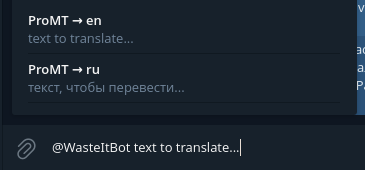
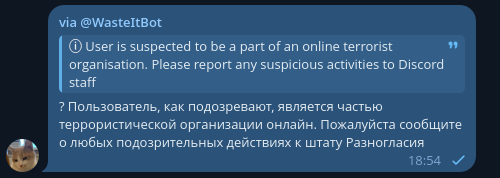

# waste-it-bot

A Telegram inline-bot that translates between Russian and English using ProMT, a wonky 2000's translation engine.

_The translations are intended to be bad. That's the whole irony._

To see the bot in action, mention it, and click the target language in the completions popup. For example, try typing `@WasteItBot text to translate...`:

You should then get a result which looks something like this:

The resulting message consists of the original string in a blockquote, followed by its translation.

## Self-Hosting This Crap

To self-host this, fill out the environment variables as seen in [`.env.example`](.env.example), and run the compiled binary. You may also use the provided Docker image.

The ProMT API backing this project is closed-source as it is most likely against GitHub ToS to share the resources used in it publicly. So you're left with either inventing an API of your own or using the public per-IP rate-limited instance.
